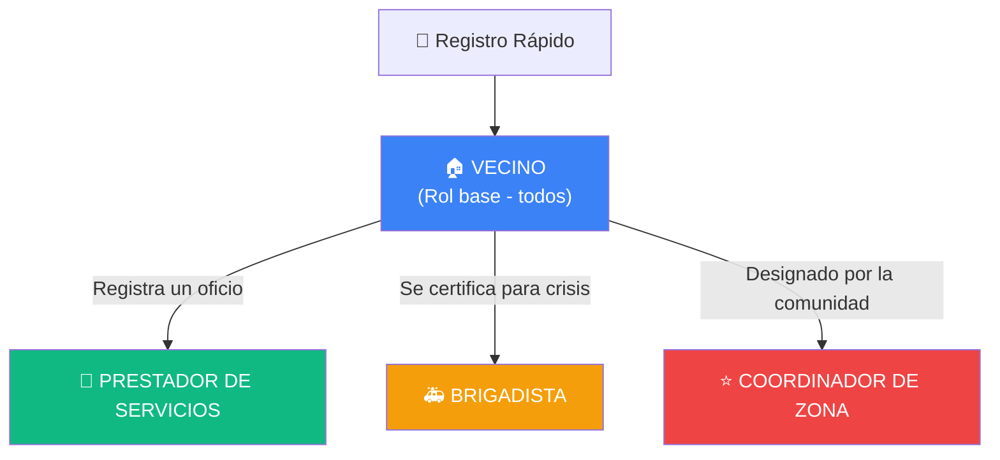
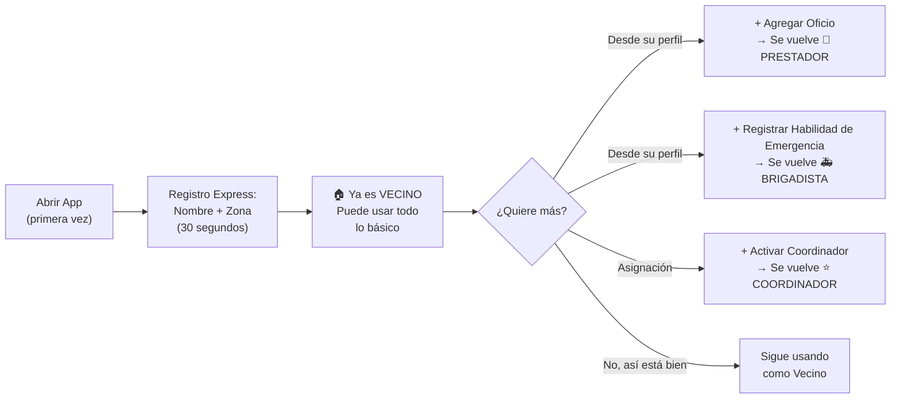

# VECINO360 — Roles del Sistema

---

## Resumen de Roles

La aplicación maneja **4 roles de usuario** que representan niveles progresivos de participación comunitaria. Un usuario puede acumular múltiples roles (un Vecino puede también ser Prestador y Brigadista a la vez).



---

## 🏠 Rol 1: VECINO (Rol Base)

> Todo usuario registrado es un Vecino. Es el rol por defecto al crear una cuenta.

### ¿Qué puede hacer?

| Modo Cotidiano | Modo Emergencia |
|---|---|
| ✅ Buscar y contactar prestadores de servicios en su zona | ✅ Ver el tablero de alertas de emergencia |
| ✅ Dar "Visto Bueno Vecinal" a prestadores que conoce | ✅ Publicar solicitudes de ayuda (alimentos, refugio, medicinas) |
| ✅ Publicar en el Muro Solidario (pedir/ofrecer préstamos, donaciones, favores) | ✅ Ofrecer recursos disponibles (agua, espacio, vehículo) |
| ✅ Responder a publicaciones de otros vecinos | ✅ Reportar situaciones de riesgo en su ubicación |
| ✅ Ver el mapa de su zona con servicios cercanos | ✅ Ver el mapa con puntos de ayuda y alertas activas |

### Datos de registro (mínimos):
- Nombre o alias
- Distrito / zona (selección o geolocalización automática)
- Teléfono (opcional, para contacto directo)

---

## 🔧 Rol 2: PRESTADOR DE SERVICIOS

> Un Vecino que registra uno o más oficios/habilidades que ofrece a la comunidad.

### ¿Qué puede hacer adicional al Vecino?

| Modo Cotidiano | Modo Emergencia |
|---|---|
| ✅ Aparecer en el Directorio de Oficios de su zona | 🔄 Su perfil se transforma: aparece como recurso técnico disponible |
| ✅ Recibir "Vistos Buenos" de vecinos que lo validan | ✅ Se le notifica si su habilidad coincide con una alerta activa |
| ✅ Definir su radio de cobertura (cuántas cuadras atiende) | ✅ Puede marcar su disponibilidad: "Disponible ahora" / "No disponible" |
| ✅ Indicar sus horarios de disponibilidad | — |
| ✅ Acumular reputación vecinal verificable | — |

### Datos adicionales al registrarse como Prestador:
- Oficio(s): selección de categorías predefinidas (Gasfitería, Electricidad, Carpintería, Cerrajería, Albañilería, Pintura, Limpieza, Jardinería, Costura, Cocina, Tecnología, Otro)
- Descripción breve de su experiencia
- Radio de cobertura (cuadras o metros)
- Disponibilidad horaria

### El sistema de "Visto Bueno Vecinal":
- Cualquier **Vecino** puede dar un Visto Bueno a un Prestador.
- Cada Vecino solo puede dar **un** Visto Bueno por Prestador (evita spam).
- El contador de Vistos Buenos es público y funciona como sistema de reputación **sin estrellas numéricas** — es un respaldo social binario: "Este vecino confía en este prestador".
- A mayor cantidad de Vistos Buenos, más arriba aparece en el directorio.

---

## 🚑 Rol 3: BRIGADISTA

> Un Vecino que se identifica como persona con capacidades de respuesta ante emergencias.

### ¿Qué puede hacer adicional al Vecino?

| Modo Cotidiano | Modo Emergencia |
|---|---|
| ✅ Aparece en la sección "Brigadistas de tu zona" (visible pero secundaria) | ⭐ Se destaca en el Directorio de Respuesta Rápida |
| ✅ Puede actualizar sus habilidades y recursos disponibles | ✅ Recibe alertas prioritarias cuando se activa el modo emergencia |
| — | ✅ Puede cambiar alertas de estado: Pendiente → En Atención → Resuelta |
| — | ✅ Su ubicación en tiempo real (si la comparte) aparece en el mapa de crisis |
| — | ✅ Puede marcar "En camino" a una alerta para coordinar respuesta |

### Datos adicionales al registrarse como Brigadista:
- Tipo de habilidad de emergencia:
  - 🏥 Primeros Auxilios
  - 🔥 Rescate / Bomberos voluntarios
  - 🩺 Personal Médico / Enfermería
  - 🚗 Transporte (tiene vehículo para evacuación)
  - 🔧 Técnico (electricista, estructuras, gas)
  - 🍳 Logística / Alimentación masiva
- Recursos disponibles: Botiquín, extintor, herramientas de corte, generador eléctrico, tanque de agua, espacio para refugio temporal
- Certificación (opcional, campo de texto libre): ej. "Cruz Roja 2024", "Bombero voluntario"

---

## ⭐ Rol 4: COORDINADOR DE ZONA

> Vecino de confianza designado para administrar y moderar la actividad comunitaria en su sector.

### ¿Qué puede hacer adicional al Vecino?

| Modo Cotidiano | Modo Emergencia |
|---|---|
| ✅ Moderar publicaciones del muro solidario (ocultar contenido inapropiado) | ⭐ **Activar / Desactivar el Modo Emergencia** para su zona |
| ✅ Verificar y destacar prestadores confiables | ✅ Priorizar alertas (reasignar nivel de severidad) |
| ✅ Enviar avisos o comunicados a los vecinos de su zona | ✅ Coordinar la asignación de brigadistas a alertas |
| ✅ Ver estadísticas básicas de su zona (cuántos vecinos, prestadores, actividad) | ✅ Publicar boletines de situación ("Estado actual de la zona") |

### ¿Cómo se obtiene este rol?
- **Para la demo/hackathon:** Cualquier usuario puede autoasignarse como Coordinador (simplificado).
- **En producción real:** Sería por votación vecinal o designación de la junta directiva del barrio/condominio.

---

## Matriz de Permisos Consolidada

| Acción | 🏠 Vecino | 🔧 Prestador | 🚑 Brigadista | ⭐ Coordinador |
|---|:---:|:---:|:---:|:---:|
| Buscar servicios y alertas | ✅ | ✅ | ✅ | ✅ |
| Publicar en muro solidario | ✅ | ✅ | ✅ | ✅ |
| Dar "Visto Bueno" a prestadores | ✅ | ✅ | ✅ | ✅ |
| Aparecer en el Directorio de Oficios | ❌ | ✅ | ❌ | ❌ |
| Publicar alertas de emergencia | ✅ | ✅ | ✅ | ✅ |
| Cambiar estado de alertas ajenas | ❌ | ❌ | ✅ | ✅ |
| Marcar "En camino" a una alerta | ❌ | ❌ | ✅ | ✅ |
| Aparecer en Directorio de Brigadistas | ❌ | ❌ | ✅ | ❌ |
| **Activar Modo Emergencia** | ❌ | ❌ | ❌ | ✅ |
| Moderar publicaciones | ❌ | ❌ | ❌ | ✅ |
| Reasignar severidad de alertas | ❌ | ❌ | ❌ | ✅ |
| Publicar comunicados de zona | ❌ | ❌ | ❌ | ✅ |

---

## Modelo de Datos del Usuario

```typescript
export interface User {
  id?: number;
  nombre: string;
  alias?: string;
  telefono?: string;
  distrito: string;
  coordenadas: { lat: number; lng: number };
  
  // Roles (acumulables)
  roles: ('vecino' | 'prestador' | 'brigadista' | 'coordinador')[];

  // Si es Prestador
  oficios?: {
    categoria: string;
    descripcion: string;
    radioCobertura: number; // en metros
    disponibilidad: string; // ej. "Lun-Vie 8am-6pm"
  }[];
  vistoBuenoCount?: number;
  validadoPor?: string[]; // IDs de vecinos que dieron Visto Bueno

  // Si es Brigadista
  habilidadEmergencia?: string[];  // Primeros Auxilios, Rescate, etc.
  recursosDisponibles?: string[];  // Botiquín, extintor, vehículo, etc.
  certificacion?: string;
  disponibleAhora?: boolean;

  // Metadatos
  fechaRegistro: string;
  syncStatus: 'synced' | 'pending';
}
```

---

## Flujo de Registro Progresivo

El sistema no obliga a llenar un formulario largo. El usuario empieza como Vecino y va añadiendo roles cuando quiera:



> [!TIP]
> **Para la demo de la hackathon**, pre-cargaremos usuarios seed con diferentes combinaciones de roles para mostrar todas las funcionalidades sin necesidad de registros en vivo.

